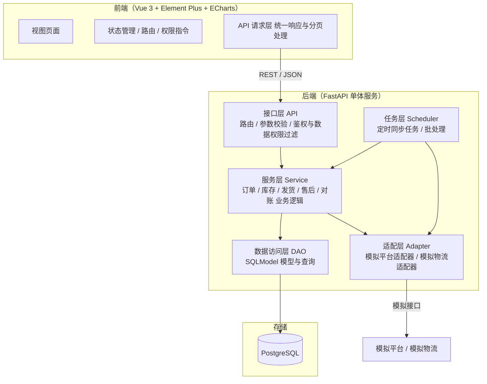
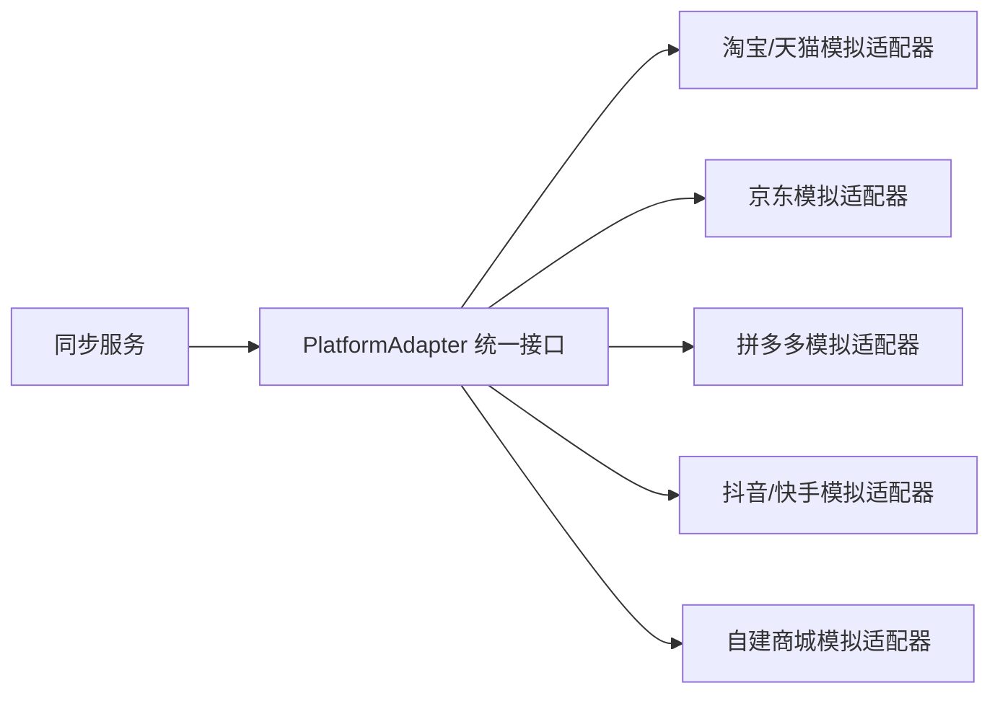
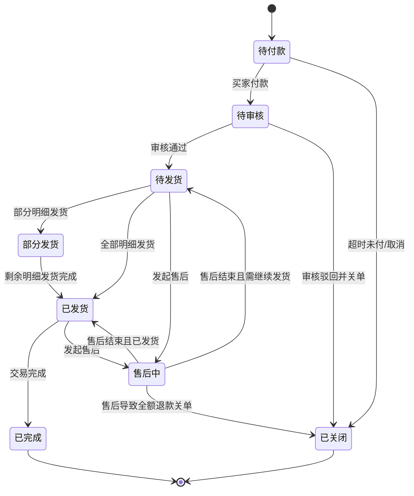
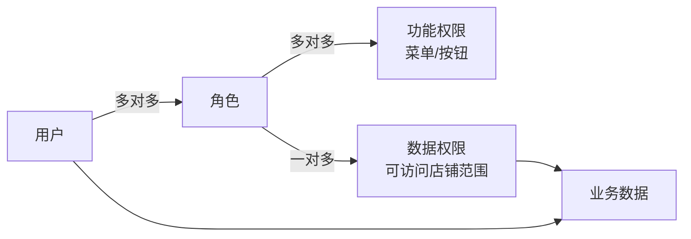
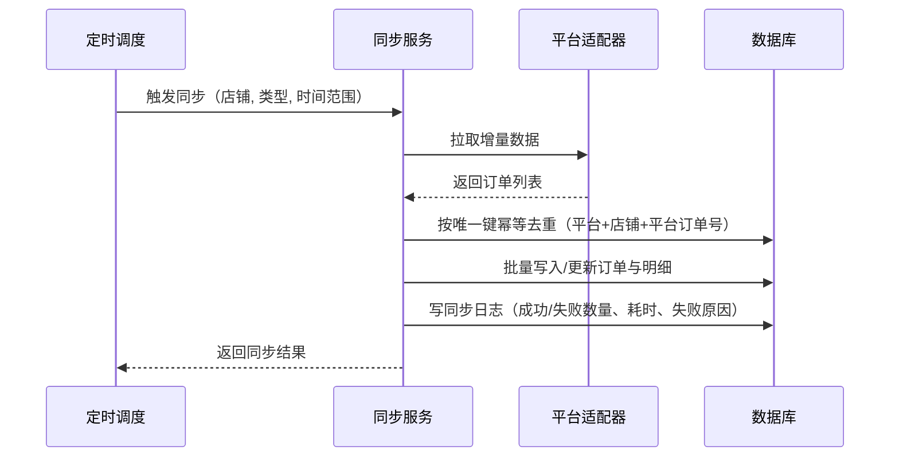

# 订单汇聚管理系统 概要设计

| 项目 | 内容 |
| --- | --- |
| 文档名称 | 订单汇聚管理系统 概要设计 |
| 文档版本 | V1.0 |
| 编制日期 | 2026-11-20 |
| 适用产品 | 订单汇聚管理系统（order-hub） |
| 文档状态 | 待确认 |
| 上游文档 | docs/需求规格说明书.md |

> 说明：本文档是设计的**总纲**，负责回答"系统由哪些部分组成、如何分层、关键技术方案是什么、分几批做"。
> 更细的内容分散到 4 份配套文档：系统架构（部署与运行时）、项目结构（分层目录、页面菜单、UI 规范与主题、时间格式）、接口设计（接口路径清单）、数据库设计（表结构、字典、字段映射）。

---

## 1 编写目的与范围

### 1.1 编写目的

本文档面向软件著作权登记、项目演示与开发实现，在需求规格说明书的基础上完成系统设计，用于：

1. 确定系统的**总体架构、模块划分与分层结构**；
2. 确定**关键技术方案**（统一订单模型、模拟平台适配器、订单状态机、库存防超卖、权限模型、同步机制）；
3. 确定**开发批次计划**与各批次交付物，作为分批开发与分批验证的依据；
4. 作为系统架构、项目结构、接口设计、数据库设计四份详细设计文档的输入与索引。

### 1.2 适用范围与读者

预期读者：架构/设计人员、开发人员、测试人员、项目管理人员与验收人员。

### 1.3 文档体系与分工

本期设计文档共 5 份，分工如下：

| 序号 | 文档 | 主要内容 | 批次 |
| --- | --- | --- | --- |
| 1 | 概要设计.md（本文档） | 设计总纲：总体架构、模块划分、技术选型、关键技术方案、开发批次计划 | 第一批 |
| 2 | 系统架构.md | 部署架构、运行时视图、核心业务时序、外部系统交互、非功能实现 | 第一批 |
| 3 | 项目结构.md | Monorepo 目录、前后端分层、命名规范、页面与菜单清单、UI 规范与科技蓝主题、时间与格式约定 | 第二批 |
| 4 | 接口设计.md | 通用约定（响应体、错误码、鉴权、分页与 page_size 上限）、完整接口路径清单 | 第二批 |
| 5 | 数据库设计.md | 表清单（按业务域）、全部表字段级结构、索引与约束、平台/渠道字典、平台字段映射对照表、初始化数据与双模式生成 | 第二批 |

> 需求规格说明书第 1.4 节提及的"界面规范、主题、时间格式、平台字段映射、平台/渠道字典、接口清单与批次计划"，因文档拆分为 5 份，分别落在上表中的项目结构、接口设计、数据库设计与本文档。

### 1.4 术语

术语与缩略语沿用《需求规格说明书》1.3 节，本文档不再重复。

---

## 2 系统概述

### 2.1 系统定位

面向电商商家的**多平台订单中台**，定位为"**汇聚 + 处理**"并重：既把淘宝/天猫、京东、拼多多、抖音/快手、自建商城多平台多店铺的订单汇聚为统一视图，也能在系统内完成订单处理、库存同步、发货、售后与对账。

### 2.2 业务范围与系统边界

**本期纳入**：平台与店铺管理、订单汇聚与统一订单模型、订单处理、商品与 SKU 映射、库存同步与防超卖、发货与物流、售后管理、财务对账、数据看板、系统管理（10 个模块 66 个功能点）。

**本期不做**（边界）：

1. 不接入真实电商开放平台，平台侧数据全部由**模拟平台**提供；
2. 不接入真实物流承运商，面单与轨迹由**模拟物流**提供；
3. 不进行真实资金收付与平台结算打款，账单以**文件导入**方式模拟；
4. 不向平台上传/上架商品，仅维护本地商品与平台商品的映射关系。

### 2.3 外部交互概览

| 外部系统 | 交互方向 | 交互内容 | 实现方式 |
| --- | --- | --- | --- |
| 模拟电商平台（含自建商城） | 双向 | 拉订单、拉库存、回写发货状态、回写库存 | 内部模拟接口 |
| 模拟物流服务 | 双向 | 取电子面单、取物流轨迹 | 内部模拟接口 |
| 平台账单文件 | 单向（入） | 导入结算账单用于对账 | 文件导入 |
| 系统用户 | 双向 | 登录、业务操作、数据查看 | 前后端 REST 接口 |

---

## 3 设计原则与约束

### 3.1 设计原则

| 原则 | 说明 |
| --- | --- |
| 简洁优先 | 以软著登记与演示为目标，架构与设计在满足功能前提下尽量简洁，不引入微服务与分布式中间件 |
| 单一订单来源 | 统一订单模型是系统内订单的唯一来源，其他模块不得另建订单数据 |
| 分层清晰 | 后端严格分层（接口层 → 服务层 → 数据访问层），业务逻辑与数据访问分离 |
| 平台可扩展 | 平台差异通过"适配器 + 配置"隔离，新增平台尽量不改动核心订单逻辑 |
| 可追溯 | 订单、库存、售后、对账的关键变更均留日志或流水，禁止无痕改数 |
| 幂等与一致 | 重复同步/重复提交不产生重复数据；涉及多表写入的操作保证事务一致 |

### 3.2 设计约束

1. 平台侧数据以模拟平台方式提供，不接入真实开放平台；
2. 单体后端 + 前后端分离，前端为静态资源；
3. 前端 Vue 3（TS）+ Vite + Element Plus + ECharts；后端 Python 3.13 + FastAPI + SQLModel；数据库 PostgreSQL；
4. 后端包管理 uv、前端包管理 pnpm；前后端代码置于同一 Monorepo；
5. 全局主题为鲜艳的科技蓝，布局、样式、主题统一；
6. 前端时间展示格式统一为 `YYYY-MM-dd hh:mm:ss`。

### 3.3 关键设计假设

1. 同一平台内订单号唯一，"平台 + 店铺 + 平台订单号"可唯一定位一条订单；
2. 一个平台 SKU 只映射一个本地 SKU（多对一）；
3. 本地 SKU 编码唯一，可作为库存与销售分析的统一口径；
4. 模拟平台可按给定时间范围返回数据，支持增量拉取；
5. 模拟数据无存量包袱，表结构变更时可直接改脚本全量重造。

---

## 4 总体架构

### 4.1 逻辑分层架构

系统采用前后端分离的三层后端结构，各层职责单一：



**分层职责**

| 层 | 职责 |
| --- | --- |
| 接口层 | 参数校验、登录与权限校验、**店铺数据权限过滤**、统一响应封装 |
| 服务层 | 业务规则、状态流转、事务与幂等控制 |
| 适配层 | 封装模拟平台/模拟物流差异，输出统一数据结构 |
| 数据访问层 | SQLModel 模型、查询与持久化 |
| 任务层 | 定时同步与批量处理，复用服务层与适配层 |

### 4.2 模块划分与职责

系统划分为 10 个业务模块，与需求规格说明书 3.1~3.10 一一对应：

| 模块编号 | 模块名称 | 职责 | 依赖 |
| --- | --- | --- | --- |
| M1 | 平台与店铺管理 | 维护平台字典、店铺授权、同步任务与日志 | — |
| M2 | 订单汇聚与统一订单模型 | 增量同步、幂等去重、字段归一化、订单列表与详情 | M1、M4 |
| M3 | 订单处理 | 审核、改价、改址、备注打标、合并拆分、异常池、状态流转 | M2、M5 |
| M4 | 商品与 SKU 映射 | 本地 SPU/SKU、平台商品、SKU 映射 | M1 |
| M5 | 库存同步与防超卖 | 主库存、流水、共享、占用释放、回写、预警、盘点 | M4 |
| M6 | 发货与物流 | 待发货、面单、打单、发货回传、轨迹、异常预警 | M3、M5 |
| M7 | 售后管理 | 售后单汇聚、工单处理、退款同步、关联、超时预警、原因分析 | M2、M5 |
| M8 | 财务对账 | 账单导入、订单匹配、差异处理、结算汇总、毛利、导出 | M2、M7 |
| M9 | 数据看板 | 经营总览、渠道对比、商品分析、履约分析、售后、库存、下钻 | M2~M8（只读） |
| M10 | 系统管理 | 用户、角色、功能权限、数据权限、操作日志、登录认证 | — |

**依赖说明**：M1 是全系统数据入口；M2 是核心地基；M4、M5 是订单处理与履约的横向前提；M9 只读、依赖全部业务模块；M10 为所有模块提供权限与日志支撑。

### 4.3 模块与功能点映射

共 10 个模块 66 个功能点，编码规则 `FR-模块序号-功能序号`：

| 模块 | 功能点编号区间 | 数量 | 优先级 |
| --- | --- | --- | --- |
| M1 平台与店铺管理 | FR-01-01 ~ FR-01-07 | 7 | P0 |
| M2 订单汇聚与统一订单模型 | FR-02-01 ~ FR-02-07 | 7 | P0 |
| M3 订单处理 | FR-03-01 ~ FR-03-09 | 9 | P0 |
| M4 商品与 SKU 映射 | FR-04-01 ~ FR-04-05 | 5 | P0 |
| M5 库存同步与防超卖 | FR-05-01 ~ FR-05-07 | 7 | P0 |
| M6 发货与物流 | FR-06-01 ~ FR-06-06 | 6 | P0 |
| M7 售后管理 | FR-07-01 ~ FR-07-06 | 6 | P1 |
| M8 财务对账 | FR-08-01 ~ FR-08-06 | 6 | P1 |
| M9 数据看板 | FR-09-01 ~ FR-09-07 | 7 | P1 |
| M10 系统管理 | FR-10-01 ~ FR-10-06 | 6 | P0 |

### 4.4 业务域与数据归属

数据模型按 5 个业务域划分，与数据库设计的表清单分组一致：

| 业务域 | 归属模块 | 主要数据 |
| --- | --- | --- |
| 平台与店铺域 | M1 | 平台、店铺、同步任务、同步日志 |
| 订单域 | M2、M3 | 订单、订单明细、订单平台扩展、订单操作日志、变更记录 |
| 商品与库存域 | M4、M5 | 本地 SPU/SKU、平台商品、SKU 映射、库存、库存流水、共享配置、预警配置 |
| 履约与售后域 | M6、M7 | 发货单、物流轨迹、售后单、售后处理记录 |
| 财务与系统域 | M8、M10 | 平台账单、账单明细、对账差异、用户、角色、权限、操作日志 |

---

## 5 技术栈与选型

### 5.1 技术栈清单

| 层次 | 技术选型 | 版本/说明 |
| --- | --- | --- |
| 前端框架 | Vue 3 + TypeScript | 组合式 API |
| 前端构建 | Vite | 开发与打包 |
| UI 组件 | Element Plus | 全局主题定制为科技蓝 |
| 图表 | ECharts | 看板与统计图表 |
| 前端包管理 | pnpm | Node.js 22 |
| 后端语言 | Python | 3.13 |
| 后端框架 | FastAPI | 单体服务 |
| ORM | SQLModel | 声明式模型 |
| 数据库 | PostgreSQL | 容器 postgresql-container |
| 后端包管理 | uv | 依赖与虚拟环境管理 |
| 任务调度 | 进程内定时调度（APScheduler） | 同步任务与批处理 |

### 5.2 关键选型说明

| 选型 | 理由 |
| --- | --- |
| FastAPI 单体 | 与 SQLModel 同源、类型友好、自带接口文档，单体足够支撑本期规模 |
| SQLModel | 一份模型同时用于 ORM 与接口 Schema，减少重复定义，契合"简洁"原则 |
| 进程内定时调度 | 不引入 Celery/Redis 等中间件，降低部署复杂度，满足演示与验证需求 |
| 适配器模式 | 把平台差异集中到适配层，模拟平台与真实平台可平滑替换 |
| 前端指令级权限 | 菜单与按钮按权限动态渲染，配合后端双校验 |

---

## 6 关键技术方案

### 6.1 统一订单模型与归一化

**设计思路**：订单拆为三层——订单主表（统一字段）、订单明细表（商品行）、订单平台扩展表（平台特有字段键值对）。平台差异只落在适配层与扩展表，业务逻辑只面向统一结构。

**统一字段口径**

| 维度 | 统一字段 |
| --- | --- |
| 标识 | 平台编码、店铺、平台订单号、本地订单号 |
| 买家与收货 | 买家账号、收件人、电话、省市区、详细地址 |
| 金额 | 商品金额、优惠金额、运费、实付金额 |
| 状态 | 统一状态（8 态）+ 平台原始状态（存扩展表） |
| 时间 | 下单时间、付款时间、发货时间、完成时间 |
| 其他 | 备注、标签、订单来源、是否异常 |

**归一化规则**

1. 各平台字段按《数据库设计》中的"平台字段映射对照表"映射到统一字段；
2. 无法归一的平台特有字段写入订单平台扩展表（键值对），订单详情页可查看；
3. 平台原始状态映射为统一状态，原始状态值保留在扩展表中；
4. 重复同步以平台最新数据更新本地订单，并写变更记录；已进入发货流程的订单关键字段（金额、收货信息）不被直接覆盖，需人工确认。

### 6.2 模拟平台适配器

**设计思路**：为每个平台实现一个适配器，对外暴露统一能力接口；模拟平台在系统内部按平台规则生成并返回数据。



**适配器统一能力**

| 方法 | 说明 |
| --- | --- |
| fetch_orders | 按店铺与时间范围获取订单（支持增量） |
| fetch_inventory | 获取平台侧库存 |
| push_shipment | 回写发货状态 |
| push_inventory | 回写可售库存 |
| fetch_after_sales | 获取售后申请 |
| fetch_bill | 获取账单数据 |

**平台差异配置化**：平台编码、名称、图标、排序、启停状态、原始状态与统一状态的映射、字段映射规则均通过配置（平台字典 + 映射表）维护，新增平台以新增配置与适配器实现为主。

### 6.3 订单状态机

订单统一状态 8 态：待付款、待审核、待发货、部分发货、已发货、已完成、已关闭、售后中。



**实现要点**

1. 状态流转以**状态机表**驱动（当前状态 → 允许的下一状态集合），非法流转直接拒绝；
2. 每次流转写入订单操作日志（操作人、时间、前后状态、来源：系统同步/人工操作）；
3. 改价、改址等操作仅在"已发货"之前允许；
4. 部分发货基于订单明细的发货数量判定，全部明细发完自动转"已发货"。

### 6.4 库存并发防超卖

**库存口径**：可售库存 = 主库存 − 占用库存，对外回写平台的以可售库存为准。

**并发安全**：库存占用采用数据库行级锁 + 条件更新，保证并发下不超卖。

```sql
-- 伪代码：下单占用库存，只有可售充足时才成功
UPDATE inventory
SET occupied_qty = occupied_qty + :qty
WHERE sku_id = :skuId
  AND (main_qty - occupied_qty) >= :qty;
-- 影响行数为 0 表示库存不足，占用失败
```

**关键规则**

1. 任何库存变动（采购入库/订单占用/订单释放/发货扣减/退货入库/盘点调整）必须写入库存流水，禁止无流水改数；
2. 占用与释放成对出现；发货确认时扣减主库存并减少占用；
3. 库存回写平台失败需记录并可重试；
4. 变动、占用、回写尽量置于同一事务；跨系统的回写失败按"本地成功 + 回写待重试"处理。

### 6.5 权限模型（RBAC + 店铺数据权限）

采用"**角色功能权限 + 角色店铺数据权限**"两级模型：



| 层级 | 说明 |
| --- | --- |
| 功能权限 | 按角色分配菜单与操作按钮权限，前端按权限渲染、后端按权限校验 |
| 数据权限 | 按角色配置可访问的店铺范围；用户取所有角色店铺范围的并集 |
| 过滤落地 | 接口层在查询业务数据时自动附加"店铺 in (授权店铺)"条件；无任何店铺授权的用户不可见业务数据 |
| 日志 | 关键操作（审核、改价、改址、发货、退款、权限变更）强制写操作日志，日志不可删除 |

### 6.6 定时同步任务与幂等

**同步流程**：同步任务按店铺 + 数据类型（订单/库存/售后）配置频率与起始时间，定时触发或手动触发。



**幂等保障**

1. 订单唯一键"平台 + 店铺 + 平台订单号"，存在则更新、不存在则插入；
2. 同步日志记录每次执行的时间范围与结果，失败可重试；
3. 批量写入采用分批提交，避免长事务与阻塞。

### 6.7 对账匹配

1. 账单文件导入 → 解析为账单明细 → 落库形成账单批次；
2. 以"平台 + 平台订单号"与本地订单自动匹配；
3. 匹配结果分为：已匹配、金额不一致、未匹配（本地无单/账单无单）；
4. 差异项人工确认后标记已处理，处理结果可追溯；
5. 对账期封账后，历史数据不被后续同步覆盖；
6. 结合商品成本价与实收金额计算毛利，形成结算与毛利汇总。

---

## 7 开发批次计划

### 7.1 批次划分

遵循"分批交互、每批完成即暂停验证"的原则，共分 5 个批次，按业务闭环由底座到上层逐步推进：

| 批次 | 名称 | 覆盖模块 | 主要交付 |
| --- | --- | --- | --- |
| 批次 1 | 基础底座 | M10、M1 | 项目骨架、分层结构、统一响应与分页、登录认证、用户/角色/功能权限/数据权限/操作日志；平台字典、店铺授权、同步任务与日志 |
| 批次 2 | 订单汇聚核心 | M2 | 统一订单模型、模拟平台适配器、增量同步、幂等去重、订单列表与详情、同步异常处理 |
| 批次 3 | 商品与库存 | M4、M5 | 本地 SPU/SKU、平台商品、SKU 映射；主库存、流水、共享、占用释放、回写、预警、盘点 |
| 批次 4 | 订单处理与履约 | M3、M6、M7 | 审核/改价/改址/打标/合并拆分/异常池/批量/状态流转；待发货、面单、打单、发货回传、轨迹、预警；售后单汇聚与处理 |
| 批次 5 | 财务与分析 | M8、M9 | 账单导入、订单匹配、差异处理、结算汇总、毛利、导出；数据看板全部指标与下钻 |

### 7.2 各批次验证点

| 批次 | 验证点 |
| --- | --- |
| 批次 1 | 可登录；菜单按钮随权限变化；不同角色可见店铺范围不同；平台/店铺可增改启停；同步任务可配置、可手动触发、日志可查 |
| 批次 2 | 可定时/手动同步；重复同步不产生重复订单；各平台订单正确归一化；平台差异字段可查；订单列表筛选与详情完整 |
| 批次 3 | 映射可维护且有未匹配提示；库存变动均生成流水；多店铺共享同一盘库存；可售库存正确回写；并发占用不超卖 |
| 批次 4 | 审核/改价/改址/打标/合并拆分可用且留痕；状态流转合法；可获面单、批量打单、发货回传、查看轨迹；售后单可汇聚处理、退货回补库存 |
| 批次 5 | 账单可导入并自动匹配；差异可人工处理；结算与毛利可输出；看板数据准确、可筛选、可下钻且受数据权限约束 |

### 7.3 数据生成策略（minimal / full 双模式）

采用"**分批生成够用的最少数据 + 最后统一清空并全量重生成**"的策略，通过一套种子脚本以两种模式落地：

| 模式 | 用途 | 数据量 | 特点 |
| --- | --- | --- | --- |
| minimal | 各批次开发与调试 | 每张表几十条，覆盖全部表与关键状态 | 快速、够用，不追求真实分布 |
| full | 交付、演示与软著材料 | 完整规模，覆盖全部表与全部状态/场景 | 贴近真实，体现时间跨度与差异规律 |

**落地要求**

1. 脚本**幂等**且支持清空重建（truncate 后重新生成），不写增量补丁；表结构变更时直接改脚本全量重造；
2. full 模式按业务时间顺序分阶段生成：平台 → 店铺 → 商品 → SKU 映射 → 库存 → 订单 → 发货 → 售后 → 账单，保证关联完整、无孤立数据；
3. 使用固定随机种子，保证结果可复现；
4. 数据满足需求规格说明书 4.3 节要求（覆盖范围、真实性、规模、时间跨度、数据差异、状态完整、关联完整）。

> 双模式的表结构与数据字段设计详见《数据库设计》，数据看板所需的统计口径与《需求规格说明书》3.9 节一致。

---

## 附录：与本设计相关的其他文档

| 文档 | 关系 |
| --- | --- |
| docs/需求规格说明书.md | 上游需求依据 |
| docs/系统架构.md | 本文档的展开：部署与运行时、业务时序 |
| docs/项目结构.md | 分层目录、页面菜单、UI 规范与主题、时间格式 |
| docs/接口设计.md | 接口路径清单与通用约定 |
| docs/数据库设计.md | 表结构、字典、字段映射、数据生成 |

（文档结束）
