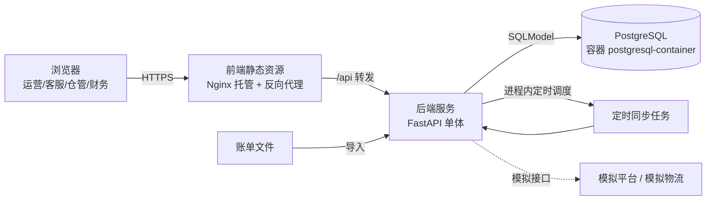
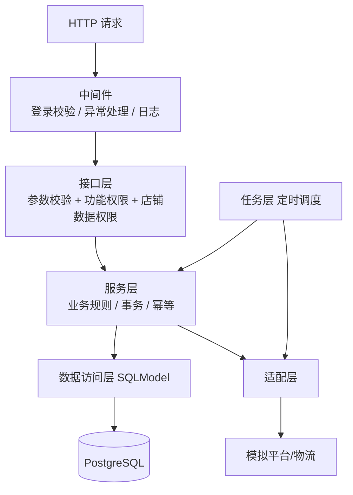
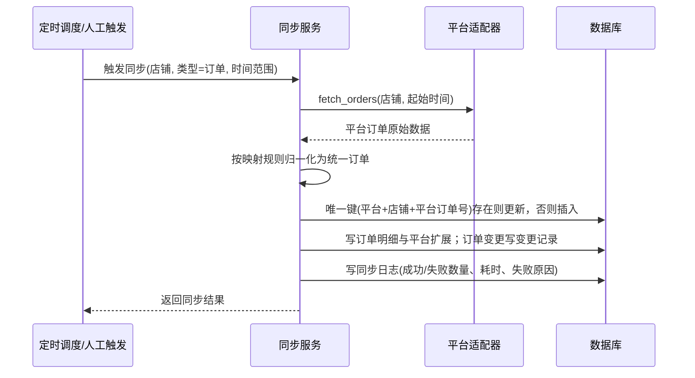
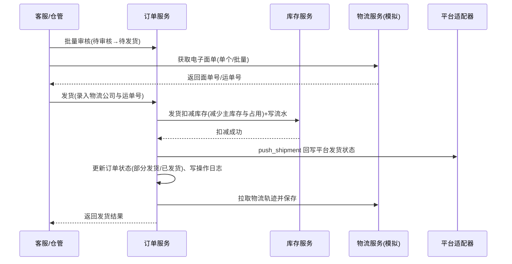
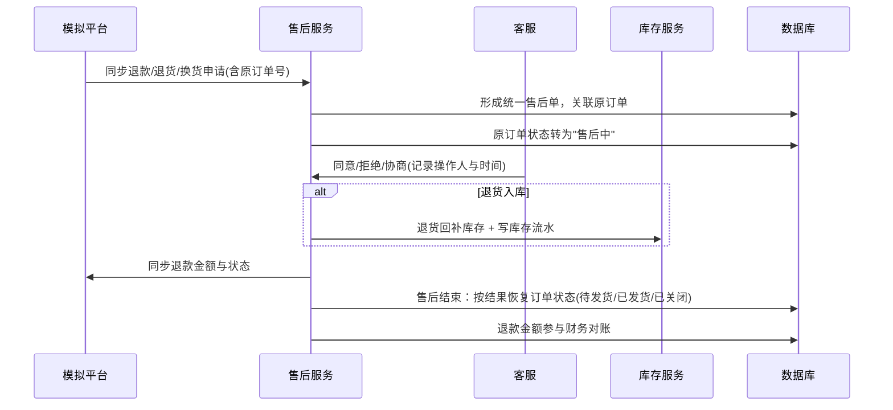
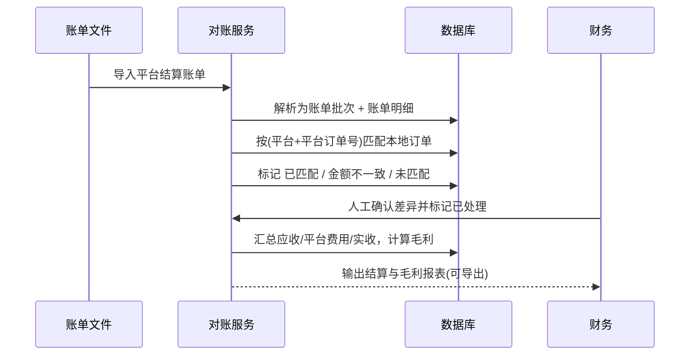
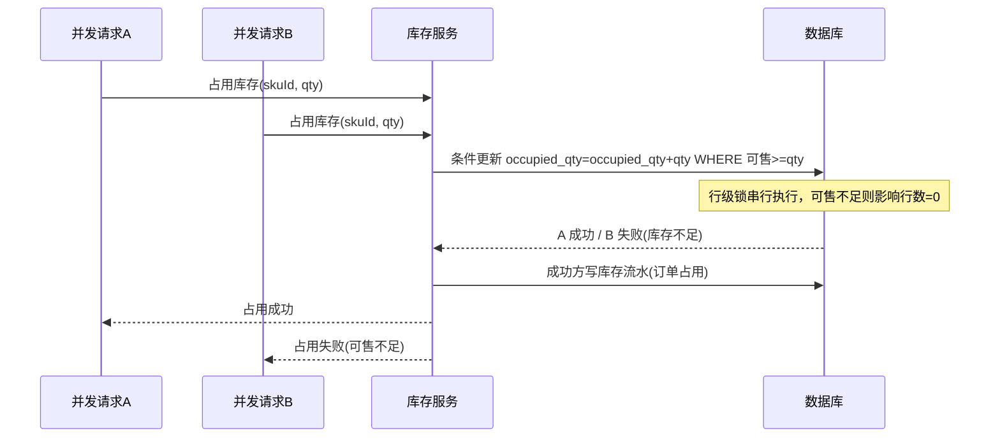

# 订单汇聚管理系统 系统架构

| 项目 | 内容 |
| --- | --- |
| 文档名称 | 订单汇聚管理系统 系统架构 |
| 文档版本 | V1.0 |
| 编制日期 | 2026-11-20 |
| 适用产品 | 订单汇聚管理系统（order-hub） |
| 文档状态 | 待确认 |
| 上游文档 | docs/需求规格说明书.md、docs/概要设计.md |

> 说明：本文档是《概要设计》的展开，回答"系统如何部署、运行时如何组织、核心业务如何流转、外部系统如何交互、非功能需求如何落地"。
> 目录结构、页面菜单与 UI 规范见《项目结构》；接口路径见《接口设计》；表结构见《数据库设计》。

---

## 1 编写目的与范围

本文档描述系统的**部署架构、运行时视图、核心业务时序、外部系统交互**与**非功能实现方案**，作为开发实现、联调与部署的依据。

读者：架构/设计人员、开发人员、测试与运维人员。

---

## 2 部署架构

### 2.1 部署拓扑

系统为"**单体后端 + 前端静态资源 + 单数据库**"的简洁部署形态，前端通过 Nginx 托管静态资源并反向代理后端接口。

### 2.2 运行环境与组件清单

| 组件 | 说明 | 备注 |
| --- | --- | --- |
| 前端运行 | Node.js 22 + pnpm，构建产物为静态资源 | 开发用 Vite dev server，部署用 Nginx |
| 后端运行 | Python 3.13 + uv 管理依赖，FastAPI 服务 | 单体服务，单进程/多进程均可 |
| 数据库 | PostgreSQL，WSL2 Docker 容器 `postgresql-container` | 用户/密码/库均为 `order-hub` |
| 定时调度 | 进程内调度（APScheduler） | 随后端服务启动 |
| 模拟平台/物流 | 后端内置模块，不对外部署 | 通过内部接口调用 |

### 2.3 部署与运行方式

| 环节 | 方式 |
| --- | --- |
| 本地开发 | 前端 `pnpm dev`（Vite）+ 后端 `uv run`，前端代理 `/api` 到后端 |
| 构建 | 前端 `pnpm build` 产出静态资源；后端无需编译 |
| 部署 | Nginx 托管前端静态资源并反向代理 `/api`；后端以服务方式启动 |
| 数据库初始化 | 执行建表与初始化数据脚本（minimal/full 双模式，见《数据库设计》） |
| 配置管理 | 数据库连接、密钥、调度开关等以环境变量/配置文件维护 |

---

## 3 运行时视图

### 3.1 分层运行时

后端运行时由**接口层、服务层、适配层、数据访问层、任务层**构成；请求从接口层进入服务层，服务层是唯一业务入口。

### 3.2 一次请求的处理链路

1. 请求进入中间件，完成登录状态校验与全局异常捕获；
2. 接口层解析并校验参数，校验功能权限；
3. 接口层按当前用户的**数据权限**注入店铺过滤条件；
4. 服务层执行业务规则与状态流转，必要时开启事务、通过适配层调用外部模拟接口；
5. 数据访问层完成持久化；
6. 统一响应体封装后返回前端；关键操作异步写入操作日志。

### 3.3 服务启动与初始化

| 步骤 | 内容 |
| --- | --- |
| 启动 | 后端启动时加载配置、建立数据库连接池、注册路由与中间件 |
| 调度 | 启动进程内定时调度，加载已启用的同步任务配置 |
| 初始化 | 数据库初始化脚本按 minimal/full 模式生成基础数据与演示数据 |
| 前端 | 启动后拉取当前用户信息与权限，动态生成菜单与路由 |

> 同步任务在服务启动时恢复定时计划；服务停止期间错过的同步，下次触发时按时间范围增量补齐。

---

## 4 核心业务时序

### 4.1 订单同步链路

从模拟平台拉取订单 → 幂等去重 → 归一化落库 → 写同步日志。

**要点**：订单落库后触发商品映射校验（未匹配标记）与库存占用（下单即占用）。

### 4.2 订单处理与发货链路

审核 → 待发货 → 取面单 → 发货回传 → 扣减库存 → 物流轨迹。

**要点**：发货扣库存与订单状态更新在同一事务内完成；平台回写失败单独记录并可重试，不阻塞本地发货结果。

### 4.3 售后链路

售后汇聚 → 处理 → 退款同步 → 库存回补 → 影响对账。

### 4.4 对账链路

账单导入 → 解析落库 → 自动匹配 → 差异处理 → 结算与毛利。

**要点**：对账期封账后，历史数据不被后续同步覆盖。

### 4.5 库存并发防超卖时序

**要点**：以数据库条件更新（行级锁）保证并发安全；库存的每一次变动（采购入库/订单占用/订单释放/发货扣减/退货入库/盘点调整）均写入库存流水。

---

## 5 外部系统交互设计

### 5.1 模拟电商平台

| 交互 | 方向 | 触发 | 说明 |
| --- | --- | --- | --- |
| 获取订单 | 拉取 | 定时/手动同步 | 按店铺与时间范围返回订单与明细 |
| 获取库存 | 拉取 | 定时同步 | 返回平台侧库存（用于比对） |
| 回写发货 | 推送 | 发货后 | 回传物流公司与运单号 |
| 回写库存 | 推送 | 库存变动后 | 回传可售库存 |
| 获取售后 | 拉取 | 定时/手动同步 | 返回退款/退货/换货申请 |

平台范围固定 5 个：淘宝/天猫、京东、拼多多、抖音/快手、自建商城；新增平台以新增适配器与配置为主。

### 5.2 模拟物流服务

| 交互 | 方向 | 说明 |
| --- | --- | --- |
| 获取电子面单 | 请求 | 返回面单号与运单号，支持批量 |
| 获取物流轨迹 | 请求 | 返回轨迹节点，用于订单详情与物流跟踪 |
| 物流异常 | 内部产生 | 长时间无更新、签收异常等生成预警 |

### 5.3 账单文件

| 交互 | 说明 |
| --- | --- |
| 导入 | 上传平台结算账单文件，解析为账单明细落库 |
| 匹配 | 按"平台 + 平台订单号"与本地订单匹配 |
| 差异 | 未匹配、金额不一致形成差异记录，人工确认 |

### 5.4 交互契约概览

1. 所有外部交互通过**适配层**统一封装，输入输出为系统内部标准结构，屏蔽平台差异；
2. 外部调用失败统一记录失败原因，支持重试，不静默丢失（对应 NFR-A-01）；
3. 面单、轨迹、账单均为模拟数据，不依赖真实第三方服务；
4. 平台差异字段统一落入订单平台扩展表，便于查看与追溯。

---

## 6 非功能实现

### 6.1 性能实现（对应 NFR-P）

| 需求 | 实现方案 |
| --- | --- |
| 列表查询 ≤ 2s | 常用筛选字段建索引；服务端分页；只查询必要字段 |
| 看板 ≤ 3s | 看板指标按时间/平台/店铺维度聚合查询；必要时对统计结果做轻量缓存 |
| 批量操作不阻塞 | 批量审核/发货分批提交，返回成功与失败明细 |
| 同步不阻塞业务 | 同步批量写入、分批提交，与在线业务共用连接池但不抢占式运行 |
| 分页上限 | 分页接口设定 `page_size` 上限并校验，超出报错或截断，防止单次请求过大失败 |

### 6.2 安全与权限实现（对应 NFR-S）

| 需求 | 实现方案 |
| --- | --- |
| 身份认证 | 除登录外所有接口校验登录状态，未登录返回统一鉴权错误 |
| 功能权限 | 前端按权限渲染菜单与按钮，后端接口二次校验 |
| 数据权限 | 接口层统一注入"店铺 in (授权店铺)"过滤条件 |
| 密码安全 | 密码加盐哈希存储，禁止明文 |
| 操作留痕 | 关键操作强制写操作日志，日志只读不可删 |
| 数据一致性保护 | 金额、库存等敏感字段变更走服务层校验与事务，禁止直接改数 |

### 6.3 可用性与可靠性实现（对应 NFR-A）

| 需求 | 实现方案 |
| --- | --- |
| 同步可靠 | 同步结果写日志，失败可查看、可重试 |
| 幂等 | 订单唯一键去重；回写与提交流程做幂等控制 |
| 事务完整 | 发货扣库存、售后回补库存等多表写入置于同一事务 |
| 错误提示 | 统一错误码与可读提示，业务失败返回明确原因 |
| 数据可追溯 | 订单/库存/售后/对账关键变更均留日志或流水 |

### 6.4 可维护性与可扩展性实现（对应 NFR-M）

| 需求 | 实现方案 |
| --- | --- |
| 结构简洁 | 单体后端 + 前后端分离，不引入分布式中间件 |
| 平台可扩展 | 适配器 + 配置（字典、状态映射、字段映射）隔离平台差异 |
| 接口规范 | 统一响应结构与命名约定（见《接口设计》） |
| 分层清晰 | 接口/服务/适配/数据访问分层，业务逻辑与数据访问分离 |
| 配置化管理 | 平台字典、状态映射、安全库存阈值等配置化，避免硬编码 |

---

## 7 与数据库的关系

本文档涉及的所有业务数据（订单、库存、售后、账单等）的**表结构、索引、字典与字段映射**详见《数据库设计》；业务模块与数据表的归属关系见《概要设计》4.4 节（5 个业务域）。

（文档结束）
