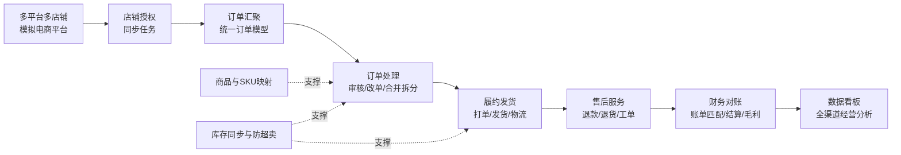
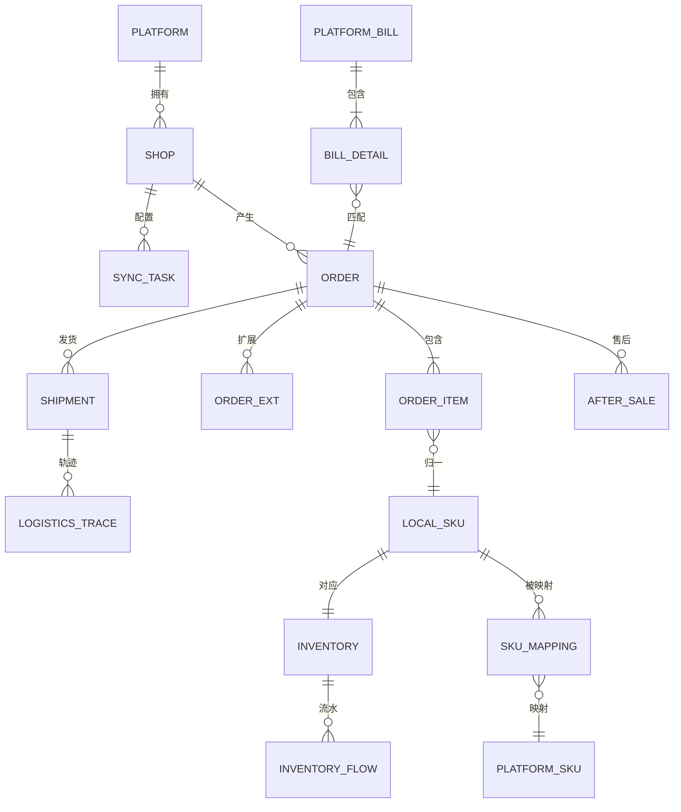
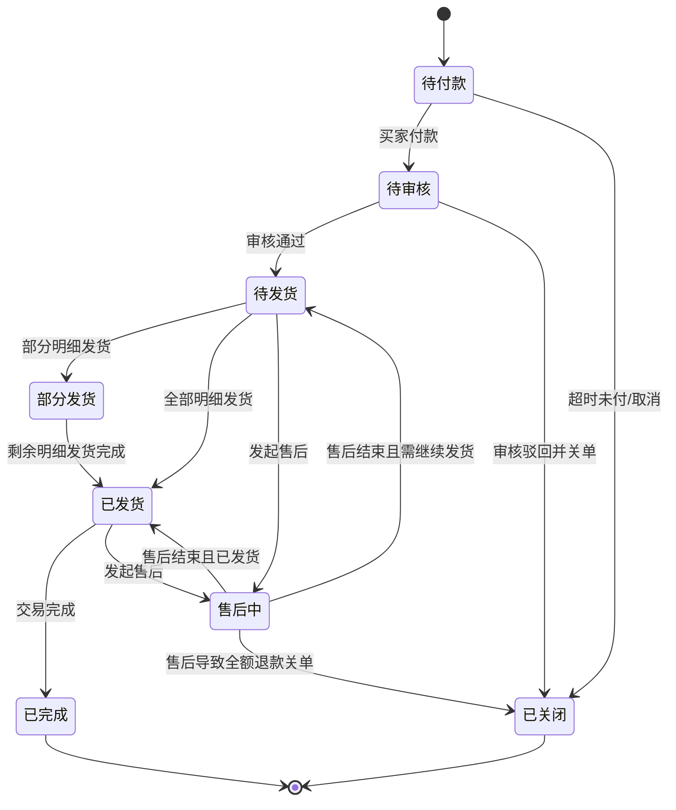

# 订单汇聚管理系统 需求规格说明书

| 项目 | 内容 |
| --- | --- |
| 文档名称 | 订单汇聚管理系统 需求规格说明书 |
| 文档版本 | V1.0 |
| 编制日期 | 2026-11-20 |
| 适用产品 | 订单汇聚管理系统（order-hub） |
| 文档状态 | 已确认 |

> 说明：本文档面向软件著作权登记、项目演示与开发实现，内容覆盖需求、功能、数据与非功能需求。
> 界面规范、主题、时间展示格式、页面与菜单清单、平台字段映射对照表、平台/渠道字典、接口清单与开发批次计划统一放在《概要设计》中，本文档不再重复。

---

## 1 引言

### 1.1 编写目的

本文档定义"订单汇聚管理系统"的业务范围、功能需求、数据需求与非功能需求，用于：

1. 统一项目干系人对系统范围与功能的理解，作为需求确认的依据；
2. 作为概要设计、数据库设计、接口设计与项目结构设计的输入；
3. 作为开发、测试与验收的依据；
4. 作为软件著作权登记的项目需求文档。

预期读者：需求/产品人员、设计人员、开发人员、测试人员、项目管理人员及验收人员。

### 1.2 项目背景与建设目标

**背景**

电商商家的经营渠道日趋分散：同一商家往往同时在淘宝/天猫、京东、拼多多、抖音/快手等平台开设店铺，同时还运营自建商城。由此带来一系列问题：

1. **多后台反复切换**：每个平台一套后台，客服每天在多个页面之间来回切换，操作效率低；
2. **订单容易漏处理**：同款商品在多个平台售卖，订单需逐平台查看与处理，人工核对容易漏单、错单；
3. **库存相互孤立**：各平台库存独立维护，无法共享同一盘货，容易超卖或压货；
4. **状态不透明**：发货、物流、退款状态分散在各平台，管理者无法看到全局；
5. **对账依赖手工**：各平台结算口径不同，财务对账靠人工汇总，耗时长且易出错。

**建设目标**

建设一个面向电商商家的**多平台订单中台**，把多平台、多店铺的订单统一汇聚到一套系统中，实现"一个后台看全部订单、处理全部订单、管一盘库存、做一次对账"。具体目标：

| 目标 | 说明 |
| --- | --- |
| 统一 | 建立统一订单模型与统一订单状态，屏蔽各平台差异 |
| 高效 | 支持批量审核、批量发货等批量化处理，减少重复操作 |
| 准确 | 订单不重不漏（幂等去重），库存共享防超卖 |
| 透明 | 全渠道经营数据看板，管理者可随时掌握经营状况 |

**范围说明**

本期各平台数据采用**模拟平台**方式提供：系统内置模拟电商平台的数据生成与同步能力，完整走通"店铺授权 → 同步任务 → 订单汇聚 → 业务处理"全链路，**不接入真实的电商开放平台**（不申请真实应用资质与密钥）。该方式可完整验证系统功能，同时满足演示与软著登记需要。

### 1.3 术语与缩略语

| 术语/缩略语 | 说明 |
| --- | --- |
| OMS | Order Management System，订单管理系统 |
| 平台/渠道 | 商家经营的电商渠道，本期包含淘宝/天猫、京东、拼多多、抖音/快手、自建商城 |
| 店铺 | 商家在某一平台上的经营单元，一个平台可有多个店铺 |
| 汇聚 | 将多个平台、多个店铺的订单采集进本系统并归一化的过程 |
| 统一订单模型 | 屏蔽各平台字段差异后，本系统内部使用的标准订单结构 |
| SPU | Standard Product Unit，标准产品单元（通常指"款"） |
| SKU | Stock Keeping Unit，最小库存单位（通常指"规格"） |
| SKU 映射 | 平台商品规格与本地 SKU 之间的对应关系 |
| 主库存 | 以本系统为准、用于对外售卖的可售库存基数 |
| 占用库存 | 订单已下单但尚未发货所占用、不可再售的库存 |
| 幂等 | 同一份数据被重复同步时，不会产生重复记录或重复业务动作 |
| 增量同步 | 只采集上次同步时间点之后新增或发生变更的数据 |
| 电子面单 | 由物流服务商提供面单号并支持打印的运单形式 |
| 对账 | 将平台结算账单与本地订单、资金记录进行核对并处理差异 |
| 模拟平台 | 本系统内置的、用于替代真实电商开放平台的数据源，可生成与返回订单、库存、物流等模拟数据 |

### 1.4 参考资料

| 编号 | 名称 | 说明 |
| --- | --- | --- |
| R1 | GB/T 8567-2006 计算机软件文档编制规范 | 文档编写规范参考 |
| R2 | AGENTS.md | 项目技术栈、约束与协作约定 |
| R3 | docs/概要设计.md | 概要设计文档（界面规范、字段映射、批次计划等） |

---

## 2 总体描述

### 2.1 产品定位与价值

**产品定位**：面向电商商家的多平台订单中台，定位为"汇聚 + 处理"并重。既要把多平台订单汇聚成统一视图，也要能在系统内完成订单处理、发货、售后与对账等业务动作。

**核心价值**

| 价值维度 | 说明 |
| --- | --- |
| 降本 | 一个后台处理全部平台订单，免除多后台切换 |
| 提效 | 批量审核、批量打单、批量发货，操作可批量化 |
| 防错 | 幂等去重防漏单，库存共享防超卖 |
| 透明 | 全渠道经营看板，经营状况一目了然 |

**系统边界（本期不做的内容）**

1. 不进行真实资金收付与平台结算打款；
2. 不接入真实物流承运商，电子面单与物流轨迹为模拟数据；
3. 不向平台上传/上架商品，仅维护本地商品与平台商品的映射关系；
4. 不接入真实电商开放平台，平台侧交互全部由模拟平台承载。

### 2.2 目标用户与角色

| 角色 | 职责 | 主要诉求 | 关注的主要功能 |
| --- | --- | --- | --- |
| 超级管理员 | 系统配置与账号权限管理 | 系统稳定、权限清晰、操作可追溯 | 系统管理、同步任务、操作日志 |
| 商家老板/运营 | 经营决策与渠道管理 | 全渠道数据一屏可见、异常可预警 | 数据看板、店铺管理、库存分析 |
| 订单客服 | 订单查看与订单处理 | 查单快、改单方便、不漏单 | 订单列表/详情、订单处理、售后 |
| 仓库/发货员 | 打单与发货 | 打单批量快、发货不易错 | 发货与物流、待发货列表 |
| 财务 | 对账与结算核算 | 账单与订单自动匹配、差异可查 | 财务对账、结算汇总 |

角色权限与数据权限要求见 3.10 与 5.2。

### 2.3 业务全景与数据流向

系统整体业务从"平台数据接入"开始，到"经营数据呈现"结束，中间经过订单汇聚、订单处理、履约发货、售后服务与财务对账五个环节；商品 SKU 映射与库存同步作为横向前提贯穿订单处理与履约环节。



**关键数据流向说明**

1. 模拟平台提供订单、库存、物流与账单数据，系统通过同步任务拉取；
2. 订单经归一化后写入统一订单模型，成为全系统唯一订单来源；
3. 订单处理结果（改价、改址、打标等）记录在本地，并按需回写平台（模拟）；
4. 发货时系统向模拟平台回传发货状态，向模拟物流获取面单与轨迹；
5. 售后数据既来自平台同步，也可在系统内发起处理；
6. 平台账单导入后与本地订单匹配，形成结算与毛利数据，最终汇总到看板。

### 2.4 运行环境与技术栈

| 层次 | 技术选型 |
| --- | --- |
| 前端 | Vue 3（TypeScript）+ Vite + Element Plus + ECharts |
| 后端 | Python 3.13 + FastAPI + SQLModel |
| 数据库 | PostgreSQL |
| 包管理 | 后端 uv；前端 pnpm |
| 工程形态 | 前后端分离，前后端代码置于同一 Monorepo 仓库 |
| 部署形态 | 后端单体服务 + 前端静态资源 |

### 2.5 设计约束与假设

**设计约束**

1. 平台侧数据以模拟平台方式提供，不接入真实开放平台；
2. 项目以软著登记与对外演示为目标，需求规格、概要设计、数据库设计、接口设计等在满足功能前提下尽量简洁；
3. 系统采用单体后端 + 前后端分离的简洁架构，不引入微服务与分布式中间件；
4. 初始化数据需尽量覆盖全部数据表，数据贴近真实，并体现合理的时间跨度与数据差异规律。

**假设**

1. 每个平台店铺具有唯一的店铺标识，可唯一定位一个店铺；
2. 同一平台内订单号唯一，可作为订单幂等去重的依据；
3. 本地商品具有统一的 SPU/SKU 编码，可作为多店铺同款商品归一的依据；
4. 模拟平台能够按约定的时间范围返回订单、库存、物流与账单数据；
5. 商家具备基础的电商业务认知，无需系统提供业务培训类辅助功能。

### 2.6 外部交互说明

| 外部系统 | 交互方向 | 交互内容 | 实现方式 |
| --- | --- | --- | --- |
| 模拟电商平台（淘宝/天猫、京东、拼多多、抖音/快手） | 双向 | 拉取订单、拉取库存、回写发货状态、回写库存 | 模拟接口 |
| 模拟自建商城 | 双向 | 同上 | 模拟接口 |
| 模拟物流服务 | 双向 | 获取电子面单、获取物流轨迹 | 模拟接口 |
| 平台账单文件 | 单向（入） | 导入平台结算账单用于对账 | 文件导入 |
| 系统用户 | 双向 | 登录、业务操作、数据查看 | 前后端接口 |

---

## 3 功能需求

### 3.0 功能结构总览

系统功能划分为 10 个模块，共 66 个功能点。功能编码规则：`FR-模块序号-功能序号`。

| 模块编号 | 模块名称 | 功能点数 | 优先级 |
| --- | --- | --- | --- |
| 3.1 | 平台与店铺管理 | 7 | P0 |
| 3.2 | 订单汇聚与统一订单模型 | 7 | P0 |
| 3.3 | 订单处理 | 9 | P0 |
| 3.4 | 商品与 SKU 映射 | 5 | P0 |
| 3.5 | 库存同步与防超卖 | 7 | P0 |
| 3.6 | 发货与物流 | 6 | P0 |
| 3.7 | 售后管理 | 6 | P1 |
| 3.8 | 财务对账 | 6 | P1 |
| 3.9 | 数据看板 | 7 | P1 |
| 3.10 | 系统管理 | 6 | P0 |

**功能树**

```
订单汇聚管理系统
├── 平台与店铺管理
│   ├── 平台字典
│   ├── 店铺绑定授权
│   ├── 同步任务配置
│   └── 同步日志
├── 订单汇聚
│   ├── 增量同步
│   ├── 幂等去重
│   ├── 统一订单模型
│   └── 订单列表/详情
├── 订单处理
│   ├── 审核 / 改价 / 改址
│   ├── 备注打标
│   ├── 合并 / 拆分
│   └── 异常订单池
├── 商品与 SKU 映射
├── 库存同步与防超卖
├── 发货与物流
├── 售后管理
├── 财务对账
├── 数据看板
└── 系统管理
```

**优先级说明**：P0 为系统运行必需功能，缺一不可；P1 为业务增强功能，缺失不影响系统主流程闭环。

---

### 3.1 平台与店铺管理

**模块说明**

本模块是系统的数据入口。商家在系统中登记经营的平台，并把各平台店铺绑定到系统、授予数据访问凭证，系统据此创建同步任务采集订单等数据。所有后续功能都依赖本模块建立的店铺数据。

**功能点**

| 编号 | 功能点 | 说明 | 优先级 |
| --- | --- | --- | --- |
| FR-01-01 | 平台字典管理 | 维护平台基础信息（平台名称、平台编码、图标、排序、启用状态），支持增删改查 | P0 |
| FR-01-02 | 店铺绑定与授权 | 新增店铺时选择所属平台，录入店铺名称、店铺编码、卖家账号并完成模拟授权，生成数据访问凭证 | P0 |
| FR-01-03 | 店铺编辑与启停用 | 支持修改店铺基础信息；停用店铺后不再同步数据但历史数据保留 | P0 |
| FR-01-04 | 店铺列表与检索 | 按平台、状态、名称等条件筛选店铺，支持分页展示 | P0 |
| FR-01-05 | 同步任务配置 | 为店铺配置同步范围（订单、库存、售后）、同步频率与同步起始时间 | P0 |
| FR-01-06 | 手动触发同步 | 支持按店铺、按时间范围手动触发一次数据同步（用于补数据与验证） | P0 |
| FR-01-07 | 同步日志查看 | 记录每次同步的任务类型、时间范围、成功/失败数量、耗时与失败原因，支持查看与筛选 | P0 |

**关键业务规则**

1. 同一平台下店铺编码不可重复；店铺停用后可重新启用；
2. 未完成授权的店铺不可参与数据同步，列表中需有明显的状态提示；
3. 同步任务失败需记录失败原因，且支持按失败任务重新触发；
4. 店铺数据权限是数据隔离的主要维度（见 3.10、5.2），用户只能看到其被授权店铺的数据。

---

### 3.2 订单汇聚与统一订单模型

**模块说明**

本模块是整个系统的核心与地基。它把各平台各店铺的订单按统一结构落库，形成全系统唯一的订单数据来源。统一订单模型的设计质量直接决定后续所有业务功能的实现难度。

**功能点**

| 编号 | 功能点 | 说明 | 优先级 |
| --- | --- | --- | --- |
| FR-02-01 | 增量订单同步 | 按店铺与配置的时间范围增量拉取订单（含主订单与商品明细），支持定时与手动触发 | P0 |
| FR-02-02 | 订单幂等去重 | 以"平台 + 店铺 + 平台订单号"为唯一键去重，重复同步不产生重复订单 | P0 |
| FR-02-03 | 统一订单模型映射 | 将各平台订单字段归一化写入标准订单结构，平台特有字段存入平台扩展信息 | P0 |
| FR-02-04 | 订单列表 | 支持按店铺、平台、订单状态、下单时间、买家、订单号、商品等条件组合筛选与分页查询 | P0 |
| FR-02-05 | 订单详情 | 展示订单主信息、商品明细、收货信息、金额信息、平台扩展信息、物流信息与操作日志 | P0 |
| FR-02-06 | 同步异常处理 | 对同步失败的订单记录失败原因，支持查看、重试与人工处理 | P0 |
| FR-02-07 | 手动补单 | 在指定时间范围内补拉订单，用于解决漏单问题 | P1 |

**关键业务规则**

1. 订单唯一键为"平台 + 店铺 + 平台订单号"，这是幂等去重的根本依据；
2. 订单状态必须映射为系统内统一状态，各平台原始状态保留在平台扩展信息中；
3. 订单金额需同时保留"商品金额、优惠金额、运费、实付金额"等口径，便于后续对账；
4. 订单变更（如买家改址、平台改价）再次同步时，以平台最新数据为准更新本地订单，并记录变更日志；
5. 已进入发货流程的订单，订单关键字段（金额、收货信息）不允许被平台数据直接覆盖，需人工确认；
6. 同步过程需完整记录，任何一条订单的汇聚过程可追溯。

---

### 3.3 订单处理

**模块说明**

本模块对汇聚后的订单进行本地业务操作，是"汇聚 + 处理"定位中"处理"的主要承载。

**功能点**

| 编号 | 功能点 | 说明 | 优先级 |
| --- | --- | --- | --- |
| FR-03-01 | 订单审核 | 对订单执行审核通过/驳回，支持批量审核；审核结果影响订单能否进入发货流程 | P0 |
| FR-03-02 | 订单改价 | 修改订单实付金额或优惠金额，记录改价人与改价原因 | P0 |
| FR-03-03 | 修改收货地址 | 修改收件人、电话、收货地址，记录修改历史 | P0 |
| FR-03-04 | 备注与打标 | 添加商家备注、买家备注，支持按标签分类打标（如"急单""需核验"） | P0 |
| FR-03-05 | 订单合并 | 将同一买家、同一收货信息的多个订单合并为一个待发货批次 | P1 |
| FR-03-06 | 订单拆分 | 将一个订单按商品明细拆分为多个发货单 | P1 |
| FR-03-07 | 异常订单池 | 自动识别并集中展示异常订单（如地址异常、金额异常、长时间未付/未发） | P1 |
| FR-03-08 | 批量操作 | 列表页支持批量审核、批量打标、批量备注、批量转发货 | P0 |
| FR-03-09 | 订单状态流转 | 按统一状态机推进订单状态，记录每次流转的时间、操作人与来源 | P0 |

**关键业务规则**

1. 订单状态统一为：待付款、待审核、待发货、部分发货、已发货、已完成、已关闭、售后中（详见 4.2）；
2. 状态流转必须合法，不允许逆向跳跃流转；每次流转均写入操作日志；
3. 改价、改址等操作在订单进入"已发货"状态后不可执行；
4. 合并/拆分的订单需保持与原订单的关联关系，便于追溯；
5. 批量操作需给出成功与失败的明细结果，失败项需说明原因。

---

### 3.4 商品与 SKU 映射

**模块说明**

同一款商品在多个平台、多个店铺中往往有各自独立的商品编码，本模块建立"平台商品 ↔ 本地商品/SKU"的映射关系，使订单明细能归一到本地商品，为库存、发货与销售分析提供统一口径。

**功能点**

| 编号 | 功能点 | 说明 | 优先级 |
| --- | --- | --- | --- |
| FR-04-01 | 本地商品管理 | 维护本地 SPU 与 SKU（编码、名称、类目、规格属性、成本价、售价、状态） | P0 |
| FR-04-02 | 平台商品管理 | 展示同步获取的各平台商品与规格信息，支持按店铺、平台筛选 | P0 |
| FR-04-03 | SKU 映射维护 | 建立平台 SKU 与本地 SKU 的对应关系，支持单个维护与批量维护 | P0 |
| FR-04-04 | 未匹配提醒 | 对未建立映射的平台商品/规格进行提示，避免订单明细无法归一 | P0 |
| FR-04-05 | 映射导入导出 | 支持通过文件批量导入导出映射关系 | P1 |

**关键业务规则**

1. 一个平台 SKU 只允许映射到一个本地 SKU，一个本地 SKU 可被多个平台 SKU 映射（多对一）；
2. 未建立映射的订单明细仍需正常落库，但需在订单详情与商品模块中标记为"未匹配"；
3. 映射关系变更需记录变更历史，避免历史订单口径被篡改。

---

### 3.5 库存同步与防超卖

**模块说明**

本模块以本地库存为主库存，多店铺共享同一盘货，并把可售库存回写各平台，避免因各平台库存独立维护导致的超卖或压货。

**功能点**

| 编号 | 功能点 | 说明 | 优先级 |
| --- | --- | --- | --- |
| FR-05-01 | 主库存管理 | 维护本地 SKU 的主库存数量（可售基数），支持查询与编辑 | P0 |
| FR-05-02 | 库存流水 | 记录每一次库存变动的类型、数量、来源单号与时间，形成可追溯的流水账 | P0 |
| FR-05-03 | 库存共享策略 | 配置本地 SKU 参与共享的店铺范围，实现多店铺共享同一盘库存 | P0 |
| FR-05-04 | 库存回写平台 | 库存变动后将可售库存同步回写至各参与共享的平台店铺（模拟） | P0 |
| FR-05-05 | 库存占用与释放 | 订单下单后占用库存，订单关闭或退款后释放库存 | P0 |
| FR-05-06 | 库存预警 | 按 SKU 设置安全库存阈值，低于阈值时产生预警 | P1 |
| FR-05-07 | 库存盘点调整 | 支持人工盘点并录入实盘数量，系统自动生成盘盈/盘亏调整流水 | P1 |

**关键业务规则**

1. 可售库存 = 主库存 − 占用库存，对外回写平台的库存以可售库存为准；
2. 库存扣减需要具备并发安全性，保证不会出现超卖；
3. 任何库存变动必须生成一条库存流水，禁止无流水的直接改数；
4. 订单关闭、退款成功、换货退货入库等场景必须正确释放或回补库存；
5. 库存回写失败需记录并可重试，避免平台侧库存长时间不一致。

---

### 3.6 发货与物流

**模块说明**

本模块负责订单的履约环节：获取面单、打印、发货并回传平台，同时跟踪物流轨迹。

**功能点**

| 编号 | 功能点 | 说明 | 优先级 |
| --- | --- | --- | --- |
| FR-06-01 | 待发货列表 | 汇总审核通过、待发货的订单，支持按店铺、平台、商品、下单时间筛选 | P0 |
| FR-06-02 | 获取电子面单 | 向模拟物流服务申请电子面单单号，支持单个与批量获取 | P0 |
| FR-06-03 | 批量打单 | 批量生成并打印面单，支持按模板打印与重打 | P0 |
| FR-06-04 | 发货与回传 | 录入发货信息（物流公司、运单号）并回传平台发货状态（模拟） | P0 |
| FR-06-05 | 物流轨迹跟踪 | 拉取并展示物流轨迹节点，支持在订单详情中查看 | P1 |
| FR-06-06 | 物流异常预警 | 对长时间无更新、签收异常等物流状态产生预警 | P1 |

**关键业务规则**

1. 只有审核通过且库存满足的订单才可进入发货流程；
2. 发货后订单状态转为"已发货"，并记录发货时间与物流信息；
3. 部分发货的订单状态为"部分发货"，全部明细发货完成后转为"已发货"；
4. 一个订单可有多个包裹，需支持一对多的物流信息记录；
5. 发货回传失败需记录并可重试。

---

### 3.7 售后管理

**模块说明**

本模块汇聚并处理顾客的退款、退货、换货诉求，支持在系统内统一处理售后工单，并同步各平台售后状态。

**功能点**

| 编号 | 功能点 | 说明 | 优先级 |
| --- | --- | --- | --- |
| FR-07-01 | 售后单汇聚 | 同步各平台退款/退货/换货申请，形成统一售后单 | P1 |
| FR-07-02 | 售后工单处理 | 对售后单执行同意、拒绝、协商、备注等处理动作 | P1 |
| FR-07-03 | 退款金额与状态同步 | 记录退款金额与退款状态，并同步回平台（模拟） | P1 |
| FR-07-04 | 售后与订单关联 | 售后单关联原订单与商品明细，支持从订单跳转售后、从售后回溯订单 | P1 |
| FR-07-05 | 售后超时预警 | 对临近平台处理时限的售后单进行预警 | P1 |
| FR-07-06 | 售后原因分析 | 按售后类型与原因统计分布，供运营分析 | P2 |

**关键业务规则**

1. 售后处理过程中，原订单状态转为"售后中"，售后结束后按结果恢复或关闭；
2. 退货入库需回补库存并生成库存流水；
3. 售后处理动作需记录操作人与处理时间，形成完整处理链路；
4. 售后完成后的退款金额需参与财务对账。

---

### 3.8 财务对账

**模块说明**

本模块导入平台结算账单，与本地订单及售后数据进行匹配核对，形成结算与毛利数据。

**功能点**

| 编号 | 功能点 | 说明 | 优先级 |
| --- | --- | --- | --- |
| FR-08-01 | 平台账单导入 | 导入平台结算账单文件（模拟），解析为账单明细并落库 | P1 |
| FR-08-02 | 账单订单匹配 | 按平台订单号将账单明细与本地订单进行自动匹配 | P1 |
| FR-08-03 | 差异处理 | 展示未匹配、金额不一致等差异，支持人工确认与标记处理 | P1 |
| FR-08-04 | 结算汇总 | 按平台、店铺、时间维度汇总应收、平台费用、实收金额 | P1 |
| FR-08-05 | 毛利核算 | 结合商品成本价与实收金额计算订单/商品毛利 | P1 |
| FR-08-06 | 对账报表导出 | 导出对账结果明细与汇总报表 | P2 |

**关键业务规则**

1. 账单明细与订单的匹配依据为"平台 + 平台订单号"；
2. 金额比对需区分商品金额、运费、平台佣金、平台补贴、退款等口径；
3. 差异项必须人工确认后才能标记为已处理，处理结果可追溯；
4. 对账期一旦封账，历史数据不可被后续同步覆盖。

---

### 3.9 数据看板

**模块说明**

本模块面向运营与管理角色，提供全渠道经营数据的可视化分析，是系统对外演示的主要窗口。

**功能点**

| 编号 | 功能点 | 说明 | 优先级 |
| --- | --- | --- | --- |
| FR-09-01 | 经营总览 | 展示订单量、销售额、客单价、退款额等核心指标及趋势 | P1 |
| FR-09-02 | 渠道与店铺对比 | 按平台、店铺对比订单量与销售表现 | P1 |
| FR-09-03 | 商品销售分析 | 展示热销商品排行、品类分布与销售趋势 | P1 |
| FR-09-04 | 订单与履约分析 | 展示订单状态分布、发货时效、履约完成情况 | P1 |
| FR-09-05 | 售后分析 | 展示售后单量、退款金额、售后原因分布 | P2 |
| FR-09-06 | 库存分析 | 展示库存周转、库存预警、缺货风险 | P2 |
| FR-09-07 | 条件筛选与下钻 | 支持按时间范围、平台、店铺筛选，并支持从汇总下钻到明细 | P1 |

**关键业务规则**

1. 看板数据需按平台与店铺的数据权限进行过滤，用户不可见无权店铺的数据；
2. 统计口径需与订单、售后、对账模块保持一致，避免同一指标出现多个数值；
3. 汇总指标需支持下钻至明细列表，便于核对。

---

### 3.10 系统管理

**模块说明**

本模块提供账号、权限与日志能力，是所有业务模块的基础支撑。

**功能点**

| 编号 | 功能点 | 说明 | 优先级 |
| --- | --- | --- | --- |
| FR-10-01 | 用户管理 | 维护系统用户（账号、姓名、所属角色、状态），支持增删改查与重置密码 | P0 |
| FR-10-02 | 角色管理 | 维护角色并为角色分配功能权限 | P0 |
| FR-10-03 | 功能权限 | 按角色控制菜单与操作按钮的可见性与可用性 | P0 |
| FR-10-04 | 数据权限 | 按角色配置可访问的店铺范围，实现数据隔离 | P0 |
| FR-10-05 | 操作日志 | 记录关键业务操作的操作人、时间、对象与内容，支持查询 | P0 |
| FR-10-06 | 登录与认证 | 用户登录、登出、身份校验与登录状态管理 | P0 |

**关键业务规则**

1. 一个用户可拥有一个或多个角色，权限取并集；
2. 数据权限按店铺维度配置，无任何店铺授权的用户不可查看业务数据；
3. 关键操作（审核、改价、改址、发货、退款、权限变更）必须写入操作日志；
4. 操作日志不可被普通用户修改或删除。

---

## 4 数据需求

### 4.1 核心实体与关系

数据实体按业务域划分为五组，概念级关系如下。

**（1）平台与店铺域**

| 实体 | 说明 |
| --- | --- |
| 平台 | 电商渠道基础信息 |
| 店铺 | 商家在某平台下的经营单元，归属一个平台 |
| 同步任务 | 店铺的数据同步配置（范围、频率、起始时间） |
| 同步日志 | 每次同步的执行记录与结果 |

关系：一个平台有多个店铺；一个店铺有多个同步任务与多条同步日志。

**（2）订单域**

| 实体 | 说明 |
| --- | --- |
| 订单（主） | 统一订单主信息，含平台、店铺、买家、金额、状态、收货信息等 |
| 订单明细 | 订单下的商品明细行，含平台商品、映射的本地 SKU、数量、金额 |
| 订单平台扩展 | 各平台特有字段的键值存储 |
| 订单操作日志 | 订单处理动作记录 |
| 发票/备注记录 | 备注、打标、改价、改址等变更记录 |

关系：一个订单有多条明细与多条扩展记录；一条明细对应一个本地 SKU（可空，未匹配时为空）。

**（3）商品与库存域**

| 实体 | 说明 |
| --- | --- |
| 本地商品（SPU） | 本地标准产品单元 |
| 本地 SKU | 本地最小库存单位，归属一个 SPU |
| 平台商品 | 从平台同步获取的商品与规格 |
| SKU 映射 | 平台 SKU 与本地 SKU 的对应关系 |
| 库存 | 本地 SKU 的主库存与占用库存 |
| 库存流水 | 库存变动明细记录 |
| 库存共享配置 | 本地 SKU 参与共享的店铺范围 |
| 库存预警配置 | 安全库存阈值设置 |

关系：一个本地 SPU 有多个本地 SKU；一个平台 SKU 映射到一个本地 SKU；一个本地 SKU 对应一条库存记录与多条库存流水。

**（4）履约与售后域**

| 实体 | 说明 |
| --- | --- |
| 发货单 | 一次发货记录，关联订单、物流公司、运单号、面单号 |
| 物流轨迹 | 运单的轨迹节点记录 |
| 售后单 | 退款/退货/换货申请，关联原订单 |
| 售后处理记录 | 售后单的处理动作记录 |

关系：一个订单可对应多个发货单；一个发货单有多条物流轨迹；一个订单可对应多个售后单。

**（5）财务与系统域**

| 实体 | 说明 |
| --- | --- |
| 平台账单 | 导入的账单批次信息 |
| 账单明细 | 账单中的逐条明细，与订单匹配 |
| 对账差异 | 匹配失败或金额不一致的差异记录 |
| 用户 / 角色 / 权限 | 账号、角色、功能权限与数据权限配置 |
| 操作日志 | 系统级关键操作记录 |

**核心关系（概念 ER）**



### 4.2 核心状态定义

**订单统一状态**

| 状态 | 说明 | 典型来源平台状态 |
| --- | --- | --- |
| 待付款 | 订单已创建但买家未付款 | 等待买家付款 |
| 待审核 | 已付款，等待商家审核 | 买家已付款 |
| 待发货 | 审核通过，等待发货 | 等待发货 |
| 部分发货 | 部分商品明细已发货 | 部分发货 |
| 已发货 | 全部商品明细已发货 | 已发货/运输中 |
| 已完成 | 交易完成 | 交易成功 |
| 已关闭 | 交易关闭或取消 | 交易关闭 |
| 售后中 | 存在进行中的售后 | 退款中/售后中 |

订单状态流转关系：



**售后单状态**

待处理 → 处理中 → 等待买家/等待商家 → 已完成 / 已关闭。

**库存变动类型**

| 类型 | 说明 | 对可售库存影响 |
| --- | --- | --- |
| 采购入库 | 新增主库存 | 增加 |
| 订单占用 | 下单占用 | 减少 |
| 订单释放 | 关单/退款释放 | 增加 |
| 发货扣减 | 发货确认扣减主库存 | 减少主库存、减少占用 |
| 退货入库 | 退货回补 | 增加 |
| 盘点调整 | 盘盈/盘亏 | 按实际调整 |

**同步任务状态**

待执行、执行中、成功、部分失败、失败。

### 4.3 初始化数据要求

系统初始化时需准备演示与验证用的基础数据，要求：

| 要求项 | 说明 |
| --- | --- |
| 覆盖范围 | 尽量覆盖系统全部数据表，排除极少使用的功能与场景 |
| 真实性 | 数据需贴近真实电商业务，商品名称、店铺名称、金额、地址等符合真实形态 |
| 规模 | 订单数据需具备一定规模，能够满足列表分页、看板统计与批量操作的真实演示 |
| 时间跨度 | 数据需跨越较长时间范围，涵盖多个自然月，体现工作日与促销期等规律 |
| 数据差异 | 各平台、各店铺的数据量、订单结构、售后率等需存在合理差异，避免平均分布 |
| 状态完整 | 订单需覆盖全部统一状态，售后单需覆盖各类售后类型与状态 |
| 关联完整 | 订单明细、库存流水、发货单、账单等需与订单保持关联一致，不产生孤立数据 |

---

## 5 非功能需求

### 5.1 性能需求

| 编号 | 需求 | 指标要求 |
| --- | --- | --- |
| NFR-P-01 | 列表查询响应 | 常规列表查询在常规数据量下响应不超过 2 秒 |
| NFR-P-02 | 看板加载响应 | 看板页面首屏数据加载不超过 3 秒 |
| NFR-P-03 | 批量操作 | 批量审核、批量发货等操作需支持分批处理，避免长时间阻塞 |
| NFR-P-04 | 同步性能 | 单次订单同步需支持批量写入，同步过程不得阻塞其他业务功能 |
| NFR-P-05 | 分页能力 | 列表接口支持分页，接口分页大小需设定上限，防止单次请求过大导致失败 |

### 5.2 安全与权限需求

| 编号 | 需求 | 说明 |
| --- | --- | --- |
| NFR-S-01 | 身份认证 | 除登录接口外，所有业务接口需校验登录状态 |
| NFR-S-02 | 功能权限 | 按角色控制菜单可见性与操作可用性，前端与后端双重校验 |
| NFR-S-03 | 数据权限 | 按店铺维度隔离数据，用户仅可访问被授权店铺的数据 |
| NFR-S-04 | 密码安全 | 用户密码需加密存储，不可明文保存 |
| NFR-S-05 | 操作留痕 | 关键业务操作需完整记录操作日志，日志不可被绕过 |
| NFR-S-06 | 数据一致性保护 | 金额、库存等敏感数据变更需校验，防止非法篡改 |

### 5.3 可用性与可靠性

| 编号 | 需求 | 说明 |
| --- | --- | --- |
| NFR-A-01 | 同步可靠性 | 同步任务失败可见、可重试，不得静默丢失数据 |
| NFR-A-02 | 幂等保障 | 重复同步、重复提交不产生重复业务数据 |
| NFR-A-03 | 事务完整性 | 涉及多表写入的业务操作（如发货扣库存）需保证事务一致 |
| NFR-A-04 | 错误提示 | 业务失败需给出明确原因提示，便于用户自助处理 |
| NFR-A-05 | 数据可追溯 | 订单、库存、售后、对账的关键变更均可追溯 |

### 5.4 可维护性与可扩展性

| 编号 | 需求 | 说明 |
| --- | --- | --- |
| NFR-M-01 | 结构简洁 | 需求、设计、数据库与项目结构在满足功能前提下尽量简洁，便于维护与登记 |
| NFR-M-02 | 平台可扩展 | 新增电商平台时，尽量通过配置与适配方式扩展，减少对核心订单逻辑的改动 |
| NFR-M-03 | 接口规范 | 前后端接口遵循统一的响应结构与命名约定 |
| NFR-M-04 | 分层清晰 | 后端需具备清晰的分层结构，业务逻辑与数据访问分离 |
| NFR-M-05 | 配置化管理 | 平台字典、状态映射、安全库存阈值等通过配置维护，避免硬编码 |

---

## 6 验收标准

系统验收以"功能可用、数据准确、流程闭环"为总体原则，具体标准如下。

| 编号 | 验收项 | 验收标准 |
| --- | --- | --- |
| AC-01 | 平台与店铺管理 | 可完成平台与店铺的新增、授权、启停用，并查看同步日志 |
| AC-02 | 订单汇聚 | 可完成定时与手动同步，重复同步不产生重复订单，同步失败可见可重试 |
| AC-03 | 统一订单模型 | 各平台订单均可正确归一化为统一订单结构，平台差异字段可查看 |
| AC-04 | 订单处理 | 审核、改价、改址、打标、合并拆分、批量操作均可正常执行并留痕，状态流转合法 |
| AC-05 | 商品与 SKU 映射 | 可建立并维护映射关系，未匹配商品有明确提示 |
| AC-06 | 库存同步与防超卖 | 库存变动均生成流水，多店铺共享同一盘库存，可售库存正确回写，不出现超卖 |
| AC-07 | 发货与物流 | 可获取面单、批量打单、发货并回传平台，物流轨迹可查看 |
| AC-08 | 售后管理 | 售后单可汇聚并处理，退货可回补库存，售后与订单可双向跳转 |
| AC-09 | 财务对账 | 账单可导入并自动匹配订单，差异可人工处理，可输出结算与毛利数据 |
| AC-10 | 数据看板 | 各维度看板数据准确、可筛选、可下钻，且受数据权限约束 |
| AC-11 | 系统管理 | 用户、角色、功能权限、数据权限、操作日志均可用且校验有效 |
| AC-12 | 非功能要求 | 性能、安全、可靠性、可维护性满足第 5 章要求 |
| AC-13 | 演示数据 | 初始化数据满足 4.3 要求，可直接支撑系统演示与软著材料制作 |

---

（文档结束）
